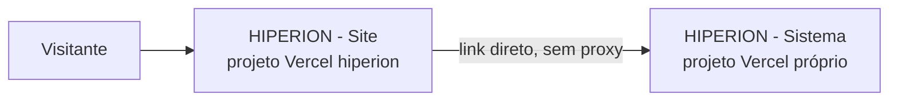

# Hiperion

[](https://hiperion-site-xi.vercel.app/pt)
[](https://hiperion-protocolos-teste.vercel.app)
[](https://vercel.com)
[](https://turso.tech)

Ponto de montagem dos dois produtos digitais da Hiperion Assessoria Contábil,
escritório de contabilidade fundado em 1969 em São Paulo. Este repositório
não tem código-fonte próprio — só reúne os dois no mesmo lugar para facilitar
o trabalho do dia a dia.

## Produtos

| Produto | O que é | Stack |
| --- | --- | --- |
| [HIPERION - Site](https://github.com/zztrevisan/hiperion-site) | Site institucional: apresentação do escritório, serviços, história e Insights, em três idiomas | Next.js, React, Three.js |
| [HIPERION - Sistema](https://github.com/zztrevisan/PROTOCOLOS-SERVER) | Hiperion Protocolos: emissão, transporte, retirada e conferência de documentos, com QR Code e assinatura | Express, Turso, PWA offline |

## Arquitetura



Os dois produtos são repositórios git independentes, montados aqui via `git
submodule`, cada um com seu próprio histórico, remoto e deploy Vercel. Eles
não compartilham domínio nem roteamento. O porquê dessa escolha está em
[Monorepo via submódulos com deploy independente](docs/adr/0001-monorepo-via-submodulos-com-deploy-independente.md).

## Primeiros passos

```bash
git clone --recurse-submodules https://github.com/zztrevisan/hiperion.git
```

Já clonou sem `--recurse-submodules`? Rode:

```bash
git submodule update --init --recursive
```

Cada produto tem seu próprio `README.md` com instruções de execução local,
variáveis de ambiente e documentação de domínio:

- [HIPERION - Site/README.md](https://github.com/zztrevisan/hiperion-site#readme)
- [HIPERION - Sistema/README.md](https://github.com/zztrevisan/PROTOCOLOS-SERVER#readme)

## Trabalhando nos submódulos

Commit e push acontecem **dentro** do submódulo, nunca aqui na raiz:

```bash
cd "HIPERION - Site"    && git push origin main
cd "HIPERION - Sistema" && git push origin main
```

A raiz só precisa de um commit novo quando o deploy do site precisa apontar
para uma revisão mais recente (`git add "HIPERION - Site"`) — o deploy do
sistema é independente deste repositório.

## Variáveis de ambiente

As duas apps usam `RESEND_API_KEY` com nomes iguais; se forem contas Resend
diferentes, configure cada uma no seu próprio projeto Vercel. As demais
variáveis (`CONTACT_FROM_EMAIL`, `EMAIL_FROM`, `TURSO_*`, `CRON_SECRET`, etc.)
não colidem. Veja `HIPERION - Site/.env.example` e
`HIPERION - Sistema/.env.example`.

## Documentação

Os links abaixo apontam para o repositório de cada submódulo (não dá para
navegar para dentro deles a partir daqui — do ponto de vista deste
repositório raiz, cada pasta de produto é só uma referência de commit).

**HIPERION - Site** ([repositório](https://github.com/zztrevisan/hiperion-site))
[Arquitetura](https://github.com/zztrevisan/hiperion-site/blob/main/docs/arquitetura/ARQUITETURA.md) ·
[Design system](https://github.com/zztrevisan/hiperion-site/blob/main/docs/arquitetura/DESIGN-SYSTEM.md) ·
[Glossário de domínio](https://github.com/zztrevisan/hiperion-site/blob/main/docs/CONTEXT.md) ·
[Decisões de arquitetura](https://github.com/zztrevisan/hiperion-site/tree/main/docs/adr)

**HIPERION - Sistema** ([repositório](https://github.com/zztrevisan/PROTOCOLOS-SERVER))
[Arquitetura](https://github.com/zztrevisan/PROTOCOLOS-SERVER/blob/main/docs/arquitetura/ARQUITETURA.md) ·
[Design system](https://github.com/zztrevisan/PROTOCOLOS-SERVER/blob/main/docs/arquitetura/DESIGN-SYSTEM.md) ·
[Fluxos operacionais](https://github.com/zztrevisan/PROTOCOLOS-SERVER/blob/main/docs/arquitetura/FLUXOS.md) ·
[Segurança](https://github.com/zztrevisan/PROTOCOLOS-SERVER/blob/main/docs/operacao/SEGURANCA.md) ·
[Glossário de domínio](https://github.com/zztrevisan/PROTOCOLOS-SERVER/blob/main/docs/CONTEXT.md) ·
[Decisões de arquitetura](https://github.com/zztrevisan/PROTOCOLOS-SERVER/tree/main/docs/adr)

**Desta raiz**
[Decisões de arquitetura](docs/adr/) ·
[`AGENTS.md`](AGENTS.md) (onde cada pedido deve ser trabalhado)

## Licença

Software proprietário de **Guilherme Andrade dos Santos Trevisan**. A
presença do código nestes repositórios não concede permissão de uso, cópia,
modificação, redistribuição ou exploração comercial.

**Copyright © 2026 Guilherme Andrade dos Santos Trevisan. Todos os direitos reservados.**
